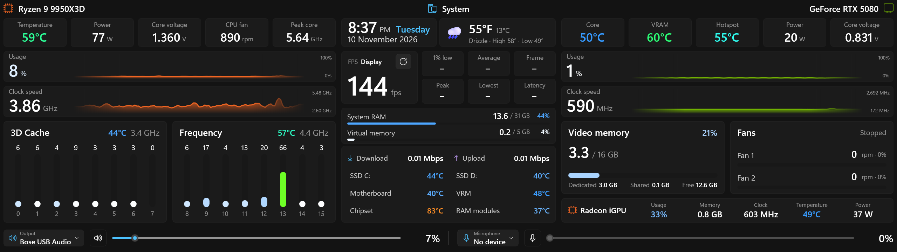
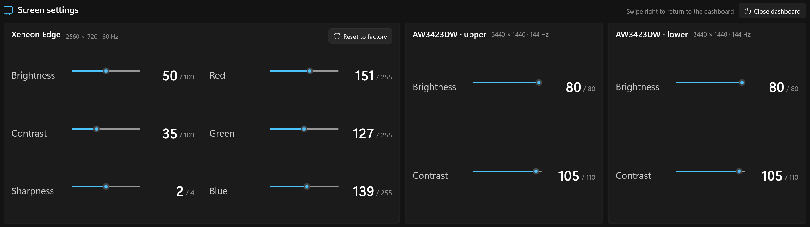

# Edge Dashboard

A native Windows (WinUI 3) hardware dashboard for the Corsair Xeneon Edge (2560×720 touch display).



- CPU and GPU temperatures, power, voltage, usage and clock graphs, per-core load for both CCDs
- Frame rate, 1% low and PC latency for the running game (NVIDIA FrameView)
- Memory, network, drive and motherboard temperatures, AMD iGPU, weather, clock
- Output and microphone volume, mute and device switching by touch
- A second page (swipe) with brightness, contrast and colour controls for each monitor

## Screen settings page

Swipe left on the dashboard to reach it; swipe right to go back.



- One card per monitor, with its resolution and refresh rate. Sliders change the monitor's own
  settings directly (over DDC/CI, the same channel the buttons on the monitor use), so they apply
  to everything on that screen, not just the dashboard.
- **Xeneon Edge:** brightness, contrast, sharpness, and the red, green and blue levels.
  **Reset to factory** restores the Edge's original picture settings.
- **Other monitors:** brightness and contrast.
- **Close dashboard** shuts the dashboard down. It needs two taps: the first turns the button red
  ("Tap again to close") for a few seconds, the second closes.

## Built on this system

The dashboard was made for, and tested on, this PC. The sensor names it reads from HWiNFO match
this hardware, so other parts may show some values as "–".

| Part | Model |
|---|---|
| Processor | AMD Ryzen 9 9950X3D (16 cores: 0–7 3D Cache, 8–15 Frequency) |
| Graphics card | NVIDIA GeForce RTX 5080 Founders Edition (16 GB) |
| Integrated graphics | AMD Radeon (drives the Xeneon Edge and runs the dashboard) |
| Motherboard | ASUS ROG Strix X870-I Gaming WiFi |
| Memory | 32 GB (2 × 16 GB) G.Skill DDR5-6000 CL30 |
| Storage | 2 × WD Black SN850X 4 TB NVMe (C: and D:) |
| Monitors | 2 × Alienware AW3423DW (3440×1440) and the Corsair Xeneon Edge (2560×720 touch) |
| Windows | Windows 11 Pro |

## Needs

- [HWiNFO64](https://www.hwinfo.com/) running with **Shared Memory Support** turned on (all sensor values come from it)
- The NVIDIA app (it provides the FrameView SDK used for frame rates)
- Windows location turned on, for the weather

## Install

Run `EdgeDashboard-Setup-<version>.exe`. It installs for the current user without an admin prompt, adds a
Start menu entry, starts with Windows, and sets the app to use the power-saving GPU. Uninstall from
Settings > Apps.

The dashboard opens full-screen on the 2560×720 display. To close it, swipe to the Screen settings
page and tap **Close dashboard** twice (the second tap confirms). No key closes it by accident.

## Build

```powershell
dotnet build -c Release          # the app
.\installer\build.ps1            # the installer, into dist\ (needs Inno Setup 6)
```

## Release

Push a version tag and GitHub builds the installer and publishes it on the Releases page:

```powershell
git tag -a v1.0.1 -m "Edge Dashboard 1.0.1"
git push origin v1.0.1
```
